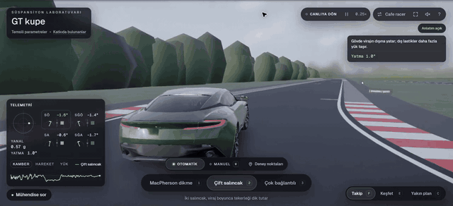

# Süspansiyon Laboratuvarı

[World-models](https://github.com/Metdez/World-models) projesinin Türkçe sürümü. Aynı araç ve yol koşullarında farklı süspansiyon geometrilerini karşılaştırın; tekerlek hareketini, kamber açısını ve yük aktarımını üç boyutlu olarak inceleyin.

## Kısa demo

Araba ve motosiklet, süspansiyon değişimleri, ağır çekim ve “Mühendise sor” özelliğinin kısa gösterimi. Önizlemeye tıklayarak MP4 videoyu açabilirsiniz.

[](docs/media/suspension-lab-demo.mp4?raw=true)

[MP4 videoyu indir](docs/media/suspension-lab-demo.mp4?raw=true)

Demo sessizdir; Türkçe sesli anlatım ve motor sesleri uygulamada kullanılabilir.

Menüler, klavye yardımı, telemetri panelleri, deney istasyonları, sürüş koçu, tekrar oynatma ve paylaşım ekranları, telefon kumandası ve izleyici oylaması Türkçedir. Yapay zekâ mühendisi Türkçe yanıt verecek şekilde yapılandırılmıştır; hizmet kullanılamadığında kurallara dayalı Türkçe açıklamalar gösterilir. Teknik kimlikler, API alanları, klavye tuşları ve lisans metinleri korunmuştur.

Geniş ekranda açıklama mesajları, sağ üstteki kontrollerin altında küçük yazılı bir kartta gösterilir. Türkçe sesli anlatım her sayfa açılışında otomatik olarak açıktır ve yeni mesajları okumaya başlar. Tarayıcı otomatik sesi engellerse uygulamadaki ilk dokunuş veya tuş sesi başlatır. **Anlatım açık / kapalı** düğmesiyle o ziyaret boyunca anlatımı yönetebilirsiniz; yeni sayfa açılışında tekrar açık başlar. Bu ayar motor ve lastik seslerinden bağımsızdır. Sesli anlatım, tarayıcının ve işletim sisteminin konuşma desteğini kullanır. Her yeni açıklama bir kez okunur; sürekli değişen sayısal göstergeler tekrar tekrar okunmaz.

Telefonda **Telemetri** ve **Mühendise sor** düğmeleri, ihtiyacınız olduğunda açılan ve kapatılabilen panelleri gösterir. Aynı anda yalnız biri açık kalır. Mühendisin cevabı soru panelinin içinde görünür; metni kaydırarak okuyabilirsiniz. Görsel viraj notları başlangıçta kapalıdır ve **Notlar** düğmesiyle açılır; sesli anlatım açık kalır. **Görünüm** düğmesi kamera seçeneklerini ve **Fizik** düğmesini açar. Bu düzen, dikey ve yatay telefon ekranlarında araç için daha fazla yer bırakır.

**Fizik** düğmesi araç üzerindeki süspansiyon çizgilerini, başlangıç konumunu ve yük oklarını açıp kapatır. Kamera seçiminden bağımsızdır: Takip, Keşfet ve Yakın plan arasında geçiş yapmak bu tercihi değiştirmez. Fizik katmanları başlangıçta kapalıdır. Ölçüm grafiği yalnızca fizik katmanları açıkken Yakın plan görünümünde gösterilir.

Telefon yatayken araç, üst ve alt menülerden ayrı bir orta alanda gösterilir. Açılan paneller için bu alan yeniden boyutlandırılır. Yatay manuel sürüşte süspansiyon seçeneklerini **Görünüm** düğmesiyle açabilirsiniz.

Yatay telefonda **Otomatik / Manuel** seçimi **Anlatım** düğmesinin hemen yanında, üstteki tek satırdadır. Dar ekranlarda diğer üst kontrolleri görmek için bu satırın sol bölümünü yana kaydırabilirsiniz; hız, vites ve senaryo açıklamaları alt alanda kalır.

## Bilgisayarınızda çalıştırma

Node.js **22.12 veya üzeri** gerekir. Windows'ta güncel Node.js LTS sürümünü kullanın.

```powershell
npm ci
npm run dev
```

Terminalde gösterilen yerel adresi tarayıcınızda açın. JavaScript ve WebGL 2 desteği gereklidir.

Üretim derlemesini yerel olarak açmak için:

```powershell
npm run build
npm run preview
```

## Temel kontroller

| Tuş | İşlev |
| --- | --- |
| W veya ↑ | Direksiyona geç / gaz ver |
| S veya ↓ | Fren / geri vites |
| A, D veya ←, → | Yön ver |
| Enter | Otomatik sürüşe bırak |
| R | Manuel sürüşte yola geri dön |
| 1, 2, 3 | Süspansiyonu değiştir |
| F, E, C | Takip, keşfet, yakın plan |
| X | Saydam görünüm |
| Q | Son anı yeniden oynat |
| G | Süspansiyonları karşılaştır |
| M | Sesi aç / kapat |
| H | Kontrolleri gizle / göster |
| ? | Klavye kısayollarını göster |

Otomatik sürüşte Boşluk tuşu duraklatır, S ağır çekimi ve A hareket büyütmesini açar. Manuel sürüşte aynı tuşların sürüş işlevleri önceliklidir.

## Bağlantılı özellikler

Tek bilgisayardaki simülasyon, otomatik ve manuel sürüş, deney istasyonları ve yerel tekrarlar Cloudflare hesabı olmadan kullanılabilir. Varsayılan `npm run dev` ve `npm run preview` çevrimdışı çalışır; mühendis kurallara dayalı Türkçe yanıt verir.

Canlı AI için önce Cloudflare panosunda Workers & Pages sayfasını açarak hesabınızın Workers kurulumunu tamamlayın. Ardından oturum açıp AI modunu başlatın:

```powershell
npx wrangler login --scopes account:read user:read workers_scripts:write ai:write
npm run dev:ai
```

Uygulama bilgisayarınızda çalışır; yalnızca mühendis sorusu, kısa konuşma geçmişi ve simülasyonun telemetrisi Cloudflare Workers AI hizmetine gönderilir. API anahtarını tarayıcıya veya kaynak dosyalara eklemek gerekmez. Cloudflare Workers AI hesabınızda etkin olmalıdır. Üretim derlemesini aynı bağlantıyla açmak için `npm run build` ardından `npm run preview:ai` kullanın.

“Ağır çekimde göster” düğmesi otomatik sürüşü hemen 0,25× hıza alır, duraklatılmışsa oynatır ve mühendisten açıklama ister. Manuel sürüş ve tekrar izleme sırasında AI hız değiştirmez. AI bağlantısı kesilirse yanıt “Kural tabanlı yanıt” olarak etiketlenir.

Canlı odalar, telefon kumandası ve sunucuya kayıt için diğer Cloudflare Worker bağlamalarının yapılandırılması gerekir; ayrıntılar `wrangler.jsonc` ve [etkinlik kılavuzunda](docs/EVENT-RUNBOOK.md) bulunur.

Bu sürümde görünen içerik de çevrildiğinden eski tekrar bağlantıları model parametrelerinin değiştiğine ilişkin bir not gösterebilir. Sayısal fizik parametreleri değiştirilmemiştir.

## Cloudflare yayını

Hesaba özel kimlikler ve yayın adresi depoda tutulmaz. `wrangler.jsonc`, hesap olmadan yerel kullanım için genel yapılandırmadır. Mevcut yerel dosyalarınızı koruyun; yalnız eksik dosyaları bir kez oluşturun:

```powershell
if (!(Test-Path wrangler.local.jsonc)) { Copy-Item wrangler.jsonc wrangler.local.jsonc }
if (!(Test-Path .env.local)) { Copy-Item .env.example .env.local }
```

Git tarafından yok sayılan `wrangler.local.jsonc` içine kendi `account_id` değerinizi ve `REPLAYS` bağlamasına **mevcut** veritabanınızın `database_id` değerini ekleyin. Vite, bu dosya varsa geliştirme ve derlemede onu seçer. Worker adı ile `ROOM`, `LIMITER`, `REPLAYS`, `AI` ve `ASSETS` bağlama adlarını koruyun.

Yok sayılan `.env.local` dosyasında `VITE_TURNSTILE_SITE_KEY` alanına kendi widget’ınızın açık site anahtarını, `SMOKE_BASE_URL` alanına yayın adresinizi yazın. Site anahtarı tarayıcıda görünür; gizli anahtar veya API token’ı değildir. Gerçek Turnstile gizli anahtarı yalnızca Worker’ın `TURNSTILE_SECRET` ayarında tutulur: `npx wrangler secret put TURNSTILE_SECRET --config wrangler.local.jsonc`. Widget’ın izin verilen domainleri kendi yayın adresinizi içermelidir. Site anahtarı yapılandırılmadan sunucuya tekrar kaydetme kullanılamaz; yerel tekrar ve paylaşım bağlantıları çalışır.

Mevcut yayını güncellemek için Cloudflare oturumu açıkken `npm run deploy` çalıştırın. Komut varlıkları ve uygulamayı derler; yayın betiği yerel hesap/veritabanı kimliklerini ve derlemenin aynı yapılandırmayı kullandığını doğrular. Eksik kimliklerle yeni kaynak oluşturmaya geçmez. Sürüm, Git kimliği ve zaman damgasından üretilir. `npm run deploy -- --dry-run` yayın yapmadan doğrular. Hesabı veya hedefi değiştiren `--config`, `--env` ve `--name` seçenekleri yerine yerel dosyayı düzenleyip yeniden derleyin.

Bekleyen tekrar veritabanı migration’ları `npx wrangler d1 migrations apply suspension-lab-replays --remote --config wrangler.local.jsonc` ile uygulanır. Anonim kullanım istatistikleri isteğe bağlıdır; genel yapılandırmada Analytics Engine bağlaması kapalıdır.

`npm run smoke:live`, `.env.local` içindeki yayın adresini kullanır. Adresi açıkça da verebilirsiniz: `npm run smoke:live -- https://example.invalid`. Diğer smoke betikleri URL argümanı veya `SMOKE_BASE_URL` ortam değişkeni alır; yerel dosyayı yüklemek için `node --env-file-if-exists=.env.local scripts/smoke-room.mjs` kullanın.

Ücretsiz kullanım için hesabı **Workers Free** planında tutun. Workers, Workers AI, SQLite Durable Objects ve D1 bu planda ücretsiz kotalar dolduğunda ilgili işlemleri reddeder; ücretli aşım kullanımı için plan yükseltmesi gerekir. Mühendisin günlük istek sayacı token veya nöron ölçmez ve tek başına fatura sınırı değildir. Cloudflare’ın harcama limiti özelliği de tüm ürünleri kapsayan kesin bir $0 sınırı sunmaz. Güncel koşullar: [Workers fiyatlandırması](https://developers.cloudflare.com/workers/platform/pricing/), [AI fiyatlandırması](https://developers.cloudflare.com/workers-ai/platform/pricing/) ve [harcama sınırları](https://developers.cloudflare.com/billing/manage/spend-management/).

## Geliştirme kontrolleri

```powershell
npm run check
npm run build
```

Tarayıcı testleri `npm run e2e` ile çalıştırılır; Playwright yapılandırmasının beklediği Chromium sürümü önceden kurulu olmalıdır.

Araç parametreleri temsili, sürüş destekleri ve lastik tutunması basitleştirilmiş modellerdir. Gerçek bir aracın üretici verisi veya güvenlik değerlendirmesi değildir. Kaynaklar ve lisans bildirimleri [CREDITS.md](CREDITS.md) dosyasındadır.
